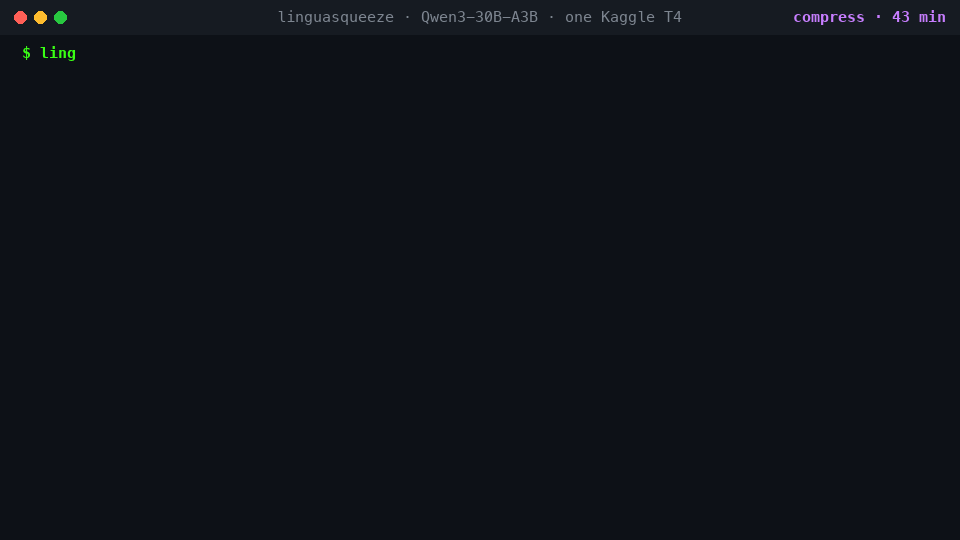

<div align="center">


## Тек жабдығыңызға емес, тіліңізге қарай сығыңыз.

**Ашық зерттеу құралы: көптілді MoE модельдері үшін тілді ескеретін кванттау.**
Сығылған модель бір орташа баға бойынша жақсы көрінуі мүмкін, ал аз таралған тілді жоғалтады. LinguaSqueeze *сіздің* тіліңіздегі мәтіндермен калибрлейді, тіліңіз шын мәнінде қолданатын сарапшыларға көбірек бит береді және тіліңіздің не жоғалтқанын көрсетеді. Qwen3-30B-A3B-де биттер мен калибрлеуді ағылшын мәтіні бойынша таңдау жад бірдей болғанда қазақ тіліне 16 есе көп зиян келтіреді.
Алғашқы дәлел — Qwen3-30B-A3B моделіндегі қазақ 🇰🇿 және орыс 🇷🇺 тілдері: 61 ГБ → 15,24 ГБ, қазақ тілінің перплексиясы +1,3%, Kaggle-дің бір тегін бейнекартасында.<br>
Бірдей өлшемде ағылшын тілінен қазақ тіліне аударма: ағылшын тіліне қарай сығылған файлдан **+5,5 chrF** жоғары.

<sub>Бұрынғы атауы <b>LinguaPrune</b>: 20.11.2026 қайта аталды, өйткені әдіс сарапшыларды алып тастаудан гөрі көбінесе аз битке сығады. Ескі сілтемелер мен <code>import linguaprune</code> жұмыс істей береді.</sub>

<p>
<a href="https://github.com/s0nakh/linguasqueeze/blob/main/LICENSE"></a>
<a href="https://github.com/s0nakh/linguasqueeze/actions/workflows/tests.yml"></a>
<a href="https://github.com/s0nakh/linguasqueeze"></a>
<a href="https://github.com/s0nakh/linguasqueeze/commits/main"></a>
<a href="#roadmap"></a>
</p>
<p>
<a href="https://pypi.org/project/linguasqueeze/"></a>
<a href="https://www.python.org/"></a>
<a href="https://pytorch.org/"></a>
<a href="https://github.com/huggingface/transformers"></a>
<a href="https://www.kaggle.com/"></a>
</p>
<p>
<a href="https://huggingface.co/Qwen/Qwen3-30B-A3B-Instruct-2507"></a>
<a href="#citation"></a>
<a href="#evaluation"></a>
<a href="#evaluation"></a>
<a href="https://github.com/s0nakh/linguasqueeze/blob/main/README.ru.md"></a>
<a href="https://doi.org/10.5281/zenodo.24281169"></a>
</p>

<p><a href="https://github.com/s0nakh/linguasqueeze/blob/main/RESEARCH.kk.md"></a></p>
🇬🇧 [English](https://github.com/s0nakh/linguasqueeze/blob/main/README.md) · 🇷🇺 [Русский](https://github.com/s0nakh/linguasqueeze/blob/main/README.ru.md) · [Зерттеу журналы](https://github.com/s0nakh/linguasqueeze/blob/main/docs/research-log.md) · [Байланысты жұмыстар](https://github.com/s0nakh/linguasqueeze/blob/main/docs/prior-art.kk.md)

<br>
<sub>Qwen3-30B-A3B-дегі екі пәрмен: Kaggle T4-тегі біздің іске қосудың сөзбе-сөз шығысы, қысқартылған (<a href="https://github.com/s0nakh/linguasqueeze/blob/main/experiments/cli/">experiments/cli</a>), 92 минут шамамен 15 секундта көрсетілген; жолдар қысқартылған.</sub>

</div>

---

### 🧭 Неден бастау керек

1. 📊 **2 минуттағы нәтиже** — [дәлелдер кестесі](#result)
2. 🔁 **Қайталау** — [`pip install linguasqueeze` және екі пәрмен](#quick-start); біздің іске қосу: [experiments/cli](https://github.com/s0nakh/linguasqueeze/blob/main/experiments/cli/)
3. 📚 **Зерттеудің толық тарихы** — [01–10 ноутбуктер, бақылау тәжірибелері, теріс нәтижелер](https://github.com/s0nakh/linguasqueeze/blob/main/RESEARCH.kk.md)

**Мазмұны:** [Нәтижелер](#result) · [Қалай жұмыс істейді](#how) · [Жылдам бастау](#quick-start) · [Кімге](#who) · [Жол картасы](#roadmap) · [Шектеулер](#limitations) · [Зерттеу](https://github.com/s0nakh/linguasqueeze/blob/main/RESEARCH.kk.md) · [Дәйексөз](#citation)

<a id="result"></a>
<a id="evaluation"></a>
## 📊 Qwen3-30B-A3B-де дәлелденді

Әр жолда ноутбук пен деректер көрсетілген. *Сим.* белгісі бар жолдар жазылған файлдағыдай бит бөлу мен калибрлеуді қолданып, кванттауды имитациялау арқылы алынған; қалған жолдар дискідегі сығылған файлдан өлшенген.

|  | Не өлшедік | Нәтиже | Дереккөз |
|---|---|---|---|
| ✅ | Файл өлшемі | **61,1 → 15,24 ГБ (4,0 есе кіші)** | [07 ноутбук](https://github.com/s0nakh/linguasqueeze/blob/main/notebooks/07_real_gptq_checkpoint.ipynb) |
| ✅ | Қазақ / орыс мәтіні (перплексия өсуі) | **+1,3% / +0,4%** | [07 ноутбук](https://github.com/s0nakh/linguasqueeze/blob/main/notebooks/07_real_gptq_checkpoint.ipynb) |
| ✅ | Ағылшын тілінде калибрлесе, өлшемі бірдей | қазақ тіліне **16 есе нашар** (+14,3%, біздікі +0,9%) | [06 ноутбук](https://github.com/s0nakh/linguasqueeze/blob/main/notebooks/06_qwen3_language_aware_gptq.ipynb), *сим.* |
| ✅ | Өлшемі бірдей, бірақ 4 бит кездейсоқ немесе ең сирек сарапшыларға берілсе | қазақ тілі +3,5…+5,0% (кездейсоқ) және +6,3% (сирек), біздікі **+1,3%** | [07c ноутбук](https://github.com/s0nakh/linguasqueeze/blob/main/notebooks/07c_allocation_control.ipynb), *сим.* |
| ✅ | Ағылшын тілінен қазақ тіліне аударма, өлшемі бірдей | ағылшын тіліне қарай сығылған файлдан **+5,5 chrF** [+3,9; +7,1] | [experiments/translation](https://github.com/s0nakh/linguasqueeze/blob/main/experiments/translation/) |
| ✅ | Шамамен 15 ГБ танымал GGUF файлдары | ең жақыны: қазақ тілі +4,3%; біздікі **+1,3%** | [09 ноутбук](https://github.com/s0nakh/linguasqueeze/blob/main/notebooks/09_popular_quants_on_kazakh.ipynb) |
| ⚠️ | Білім, толық KazMMLU (22 889 сұрақ) | −1,8 / −1,6 ұпай (kk / ru) | [07b ноутбук](https://github.com/s0nakh/linguasqueeze/blob/main/notebooks/07b_full_kazmmlu.ipynb) |

<a id="how"></a>
## ⚙️ Қалай жұмыс істейді

1. 📝 **Сіздің тіліңіздегі мәтін** — бірнеше ондаған құжат жеткілікті.
2. 🔀 **Маршрутизатор профилі** — MoE моделінің қай сарапшыларын бұл тіл шын мәнінде қолданатыны, қабат бойынша.
3. 🎚️ **Биттерді бөлу** — тіл трафигінің 90%-ын тасымалдайтын сарапшыларға 4 бит, қалғандарына 3 бит.
4. 🧮 **Әр сарапшыға GPTQ** — сол сарапшыға түскен сіздің тіліңіздің токендерінде калибрлеу.
5. 📦 **Стандартты GPTQ файлы** — бір қабаттан жазылады, сондықтан 61 ГБ модель 16 ГБ-тық бір бейнекартада өңделеді.
6. 📊 **Тексеру** — бастапқы және сығылған модель бірдей сұрақтарда: тіліңіз не жоғалтты.

<a id="quick-start"></a>
## 🚀 Жылдам бастау

```bash
pip install linguasqueeze
linguasqueeze --version   # linguasqueeze 0.8.2
```

```bash
# 1. compress: тіліңізде калибрлеу; оның трафигінің 90%-ын тасымалдайтын сарапшылар 4 бит алады, қалғандары 3
linguasqueeze compress \
  --model ./Qwen3-30B-A3B-Instruct-2507 \
  --calibration-data kazakh.txt russian.txt \
  --bits 4,3 \
  --output ./qwen3-30b-kk-ru

# 2. evaluate: екі модельге де бірдей сұрақтар; сығылған модельдің әр саны оның файлдарынан алынады
linguasqueeze evaluate \
  --original ./Qwen3-30B-A3B-Instruct-2507 \
  --compressed ./qwen3-30b-kk-ru \
  --text kk=kazakh_test.txt --text ru=russian_test.txt \
  --exam --report report.json
```

Калибрлеу және тексеру файлдары — қарапайым UTF-8 мәтін, құжаттар бос жолмен бөлінеді. Пәрмен кез келген тілдегі мәтінді қабылдайды; сапа тек қазақ және орыс тілдері үшін өлшенген.
`--exam` 07 ноутбуктің тұрақты емтиханын қосады: Belebele (kk, ru, en тілдерінде 150 мәтіннен) және әр тілге 400 сұраққа дейінгі KazMMLU іріктемесі (kk, ru), пәндер бойынша тең бөлінген (біздің іске қосуда 370 kk және 392 ru). Төмендегі KazMMLU сандары толық емтиханнан алынған (22 889 сұрақ, 07b ноутбук), сондықтан іріктемеде сәл басқа мәндер шығады. Жылдам емтихан Kaggle уақытына сыю үшін әдейі шағын; жарияланымға лайық KazMMLU сандары үшін 07b ноутбукті қолданыңыз. `compress` және `evaluate` модельді бір қабаттан жүктейді, сондықтан 61 ГБ бастапқы модель 16 ГБ-тық бір бейнекартада өңделеді; сығылған модельді іске қосуға қанша жад керегі іске қосу бағдарламасы мен контекст ұзындығына байланысты.
Әзірге қолдау көрсетіледі: `compress` — safetensors форматындағы Qwen3-MoE (Qwen3-30B-A3B-де толық іске қосылды); `evaluate` — Qwen3-MoE және Qwen3.5/3.6-MoE.

`evaluate` не көрсетеді (қысқаша), Qwen3-30B-A3B үшін сол кодпен алған сандарымызбен ([07 ноутбук](https://github.com/s0nakh/linguasqueeze/blob/main/notebooks/07_real_gptq_checkpoint.py), [07b](https://github.com/s0nakh/linguasqueeze/blob/main/notebooks/07b_full_kazmmlu.py)):

```
Original size:     61.1 GB
Compressed size:   15.2 GB
Compression:       4.0x
Perplexity kk:     +1.3%
Perplexity ru:     +0.4%
KazMMLU kk:        -1.8 pts
KazMMLU ru:        -1.6 pts
```

**Осы екі пәрмен Qwen3-30B-A3B-де іске қосылды** (Kaggle-дегі бір T4, `compress` 43 мин, `evaluate` 49 мин): 15,24 ГБ файл, 4,0 есе кіші; Belebele перплексиясы kk +0,6%, ru +0,4%, en +4,0%; KazMMLU іріктемесі kk −0,8 ұпай [−3,5; +1,9], ru −1,5 ұпай [−4,3; +1,0] (370 + 392 сұрақ). Калибрлеу мақалалары 07 ноутбуктегідей, бірақ бос жолдары алынған, сондықтан сандар 07 ноутбукке жақын, бірақ дәл сәйкес емес. Есеп, уақыты бар іске қосу қорытындысы және скрипт: [`experiments/cli/`](https://github.com/s0nakh/linguasqueeze/blob/main/experiments/cli/).

Модель жұмысының жылдамдығы мен жадысы іске қосу бағдарламасына байланысты, сондықтан `evaluate` оларды болжамайды: оларды сол жерде өлшеңіз.

## 📍 Қазір не бар (v0.8.2)

- ✅ **Тексерілді:** Qwen3-30B-A3B-де қазақ және орыс тілдері үшін `compress` → `evaluate`, 4/3 бит, стандартты GPTQ форматындағы аралас экспорт; толық KazMMLU; ағылшын тілінен қазақ тіліне аударма.
- 🧪 **Тәжірибелік:** басқа тілдер (пәрмендер кез келген тілдегі мәтінді қабылдайды, сапасы әлі өлшенбеген); Qwen3.5/3.6-MoE-де `evaluate`; басқа бит бюджеттері.
- ⛔ **Әзірге қолдау жоқ:** аралас разрядты файлдарды vLLM, llama.cpp, Ollama немесе LM Studio-да іске қосу · Qwen3.5/3.6-MoE-ді сығу · қарапайым (MoE емес) модельдер · сығылған модельдің жылдамдығы мен жадын өлшеу.

<a id="who"></a>
## 👥 Кімге және не үшін

Шағын командаға үлкен модельді қолжетімді жабдықта өз тіліне қарай сығуға және сығудан кейін сол тілдің не жоғалтқанын көруге көмектесетін құрал.

- **Модель әзірлеушілеріне** — ашық модельді пайдаланушыларыңыздың тіліне қарай сығып, шығармас бұрын тексеру.
- **Зерттеушілер мен университеттерге** — әр тіл бойынша қайталанатын өлшеулер: өлшем, перплексия, емтихан — қателігімен.
- **Шағын командаларға** — қымбат бейнекарталарсыз: бастапқы модельді сығу мен тексеруді 16 ГБ-тық бір бейнекартада іске қосуға болады, мысалы Kaggle-дегі тегін картада. Дайын модельді іске қосуға қажет жад іске қосу бағдарламасына байланысты.
- **Кез келген тілге** — қазақ, өзбек, араб, хинди, украин, вьетнам тілдері: тек өз тіліңіздегі мәтін керек. Сапа әзірге қазақ және орыс тілдері үшін өлшенген.

> **Не үшін:** сығуды әдетте өлшемі мен жылдамдығы бойынша бағалайды. LinguaSqueeze сығудан кейін тіліңізбен не болғанын да көрсетеді.


<a id="roadmap"></a>
## 🗺️ Жол картасы

**✅ Орындалды**

| 🔢 № | 🧪 Қадам | 📈 Нәтиже |
|---|---|---|
| ✅ 01–05 | Маршрутизация профилі, алып тастау, аралас дәлдік, OLMoE-дегі GPTQ | шағын MoE-де жасалған әдіс |
| ✅ 06 | Qwen3-30B-A3B: жад бірдей болғанда ағылшын тілі kk+ru-ға қарсы | ағылшын тілі қазақ тілінің перплексиясына **16 есе** қымбат |
| ✅ 07 | Нақты сығылған файл, дискіден бағаланған | **61,1 → 15,24 ГБ (4,0 есе)**, kk +1,3%, ru +0,4% |
| ✅ 07b | Толық KazMMLU (22 889 сұрақ) | −1,8 / −1,6 ұпай (4/3 бит), −1,1 / −0,4 (4 бит) |
| ✅ 07c | Мәселе бит бөлуде ме? | иә: ең жиі қолданылатын сарапшылар kk +1,3%, кездейсоқ +3,5…+5,0%, ең сирек +6,3% |
| ✅ 08 | Файл GPTQModel ішінде | kk, ru және en тілдерінде жауап береді; перплексия 07-мен 0,1% шегінде сәйкес |
| ✅ 09 | 9 танымал GGUF файлына қарсы | шамамен 15 ГБ-та алдамыз (+1,3%, ең жақыны +4,3%); 17–18 ГБ-та тең |
| ✅ 10 | 2 биттегі калибрлеу тілі | аз көмектеседі (+18,9% → +15,1%); бит бөлу маңыздырақ ([журнал](https://github.com/s0nakh/linguasqueeze/blob/main/docs/research-log.md#2026-11-14--10--does-the-calibration-language-matter-at-2-bits)) |
| ✅ HF | Екі файл да Hugging Face-те ашық | [4/3 бит](https://huggingface.co/s0nakh/Qwen3-30B-A3B-Instruct-2507-kk-ru-GPTQ-4-3bit), [4 бит](https://huggingface.co/s0nakh/Qwen3-30B-A3B-Instruct-2507-kk-ru-GPTQ-4bit); сипаттамасы EN, RU, KK |
| ✅ v0.8 | `linguasqueeze compress` / `evaluate` | мәтін файлдары бойынша кез келген тіл; Qwen3-30B-A3B-де толық іске қосылды |
| ✅ — | Калибрлеу тілі және білім (Qwen3.6, 3 бит) | айырма жоқ: KazMMLU kk +0,4 [−1,1; +1,8] |
| ✅ — | Ағылшын тілінен қазақ тіліне аударма, өлшемі бірдей | kk+ru-ға қарай сығылған файлда **+5,5 chrF** [+3,9; +7,1] |
| ✅ v0.8.2 | `pip install linguasqueeze` | [PyPI](https://pypi.org/project/linguasqueeze/)-де, GitHub Actions арқылы нұсқа тегінен жарияланады |

**🚀 Әрі қарай**

| 🚦 Күйі | 🧭 Қадам |
|---|---|
| 🔥 қазір | Танымал файлдар қазақ тілінің 10–12%-ын жоғалтатын 10–12 ГБ-қа арналған ~2,5 биттік файл |
| ⬜ | Kaggle-дегі дайын ноутбук: модельді өз тіліңізге бір басумен сығу |
| ⬜ | Біздің 4 биттік файл vLLM қозғалтқышында, сол қозғалтқыштағы танымал файлдармен салыстыру |
| ⬜ | Қазақстанның заңдары мен ресми құжаттары бойынша емтихан (kk, ru) |
| ⬜ | MERA (орыс тілі) |
| ⬜ | Екінші тіл жұбы және MoE-нің екінші тұқымдасы |

<a id="limitations"></a>
## ⚠️ Шектеулер

- Негізгі нәтиже — бір модель (Qwen3-30B-A3B) және бір іске қосу; алғашқы тіл жұбы — қазақ және орыс тілдері. Бұл кез келген модель мен кез келген тіл бірдей ұтады дегенді дәлелдемейді.
- Сығу шығынсыз емес: толық KazMMLU-да 4/3 биттік файл қазақ тілінде 1,8, орыс тілінде 1,6 ұпай жоғалтады.
- Калибрлеу тілі білімді өзгерткен жоқ. Барлық сарапшылар 3 битке сығылған Qwen3.6-35B-A3B-де (өлшемі бірдей) қазақ және орыс тілдеріндегі калибрлеу ағылшын калибрлеуімен салыстырғанда KazMMLU-да kk +0,4 ұпай [−1,1; +1,8] (3000 сұрақ) және ru +1,8 [−0,2; +3,6] (1200 сұрақ) берді — елеулі айырма жоқ. Біз өлшейтін ұтыс модельдің тілдегі мәтінмен қалай жұмыс істейтінінде (перплексия және аударма сапасы), емтихандағы білімде емес. Деректер: [`experiments/calibration-language/`](https://github.com/s0nakh/linguasqueeze/blob/main/experiments/calibration-language/).
- 2 битте калибрлеу тілі аз көмектеседі (қазақ тілінің шығыны +18,9% → +15,1%, 10 ноутбук); биттерді бөлу маңыздырақ.
- Танымал жылдам іске қосу бағдарламалары бір қабаттың сарапшыларын әртүрлі бит санымен әзірге іске қоса алмайды. GPTQModel файлды іске қосады, бірақ баяу (екі T4-те секундына шамамен 1,6 токен).
- `compress` файлдарды тек Qwen3-MoE құрылымы үшін жазады; Qwen3.5/3.6-MoE-ді `evaluate` арқылы бағалауға болады, бірақ әзірге сығуға болмайды. Қарапайым (MoE емес) модельдер қолдау таппайды.
- Деректер жинақтары мен модельдер өз лицензияларын сақтайды; [THIRD_PARTY_NOTICES.md](https://github.com/s0nakh/linguasqueeze/blob/main/THIRD_PARTY_NOTICES.md) қараңыз.

## 🤝 Қатысу

Бәрінен де күтетініміз: басқа бейнекарталар мен іске қосу бағдарламаларында қайталау, басқа MoE архитектураларын қолдау, басқа тілдердегі калибрлеу мәтіндері (тек таратуға болатындары), тәуелсіз салыстырулар және теріс нәтижелер — тілді ескеретін сығу көмектеспейтін жерлер. Алдымен ең аз қайталау мысалымен issue ашыңыз.

## 📚 Зерттеу және толық тарих

01–10 ноутбуктер, бақылау тәжірибелері, теріс нәтижелер және жолдағы әр шешім: **[зерттеу бетін ашу →](https://github.com/s0nakh/linguasqueeze/blob/main/RESEARCH.kk.md)**

<a id="paper"></a>
## 📄 Мақала

Зерттеу үш тілде препринт (CC BY 4.0) ретінде қолжетімді. Ағылшынша нұсқа — түпнұсқа; орысша және қазақша нұсқалар — аудармалар.

- 🇬🇧 [English](https://doi.org/10.5281/zenodo.24281161)
- 🇷🇺 [Русский](https://doi.org/10.5281/zenodo.24281163)
- 🇰🇿 [Қазақша](https://doi.org/10.5281/zenodo.24281169)

**Мақалаға сілтеме жасау үшін** (ағылшынша түпнұсқа):

```bibtex
@misc{akhmetova2026linguaprune_paper,
  title     = {LinguaPrune: Language-Aware Mixed-Precision Quantization of a Mixture-of-Experts LLM for Kazakh and Russian},
  author    = {Akhmetova, Sophia},
  year      = {2026},
  publisher = {Zenodo},
  doi       = {10.5281/zenodo.24281161},
  url       = {https://doi.org/10.5281/zenodo.24281161}
}
```

```text
Akhmetova, S. (2026). LinguaPrune: Language-aware mixed-precision quantization of a Mixture-of-Experts LLM for Kazakh and Russian [Preprint]. Zenodo. https://doi.org/10.5281/zenodo.24281161
```

<a id="citation"></a>
## 📝 Дәйексөз

<p align="center"><a href="#citation"></a></p>

LinguaSqueeze-ді өз жұмысыңызда қолансаңыз, оған сілтеме жасаңыз. Төмендегі әр блоктың көшіру түймесі бар; GitHub-та дәл осыны бүйір бағандағы **Cite this repository** түймесі береді ([`CITATION.cff`](https://github.com/s0nakh/linguasqueeze/blob/main/CITATION.cff) деректері бойынша).

**BibTeX**

```bibtex
@software{linguasqueeze2026,
  title   = {LinguaSqueeze: Language-aware compression for Mixture-of-Experts LLMs},
  author  = {Akhmetova, Sophia},
  year    = {2026},
  version = {0.8.2},
  url     = {https://github.com/s0nakh/linguasqueeze}
}
```

**APA**

```text
Akhmetova, S. (2026). LinguaSqueeze: Language-aware compression for Mixture-of-Experts LLMs (Version 0.8.2) [Computer software]. https://github.com/s0nakh/linguasqueeze
```

## ⚖️ Лицензия

Код [Apache-2.0](https://github.com/s0nakh/linguasqueeze/blob/main/LICENSE) лицензиясымен таратылады. Модельдердің, деректер жиынтықтарының және құралдардың өз лицензиялары бар; әр дереккөзбен салыстырылған толық тізім — [`THIRD_PARTY_NOTICES.md`](https://github.com/s0nakh/linguasqueeze/blob/main/THIRD_PARTY_NOTICES.md) ішінде. Қысқаша:

| Ресурс | Лицензия | Мұнда қалай қолданылады |
|---|---|---|
| Qwen3-30B-A3B-Instruct-2507, OLMoE-1B-7B | Apache-2.0 | Біз сығатын және өлшейтін модельдер |
| [Belebele](https://huggingface.co/datasets/facebook/belebele) (Bandarkar және т.б., ACL 2024) | CC-BY-SA-4.0 | Бағалау; тек сандар жарияланады, мәтіндер таратылмайды |
| [KazMMLU](https://huggingface.co/datasets/MBZUAI/KazMMLU) (Togmanov және т.б., ACL 2025) | CC-BY-NC-4.0 | Тек коммерциялық емес зерттеуге бағалау |
| Уикипедия (kk, ru, en) | CC-BY-SA-3.0 / GFDL | Тек калибрлеу мәтіні |
| llama.cpp, llama-cpp-python | MIT | GGUF құралдары және іске қосу |
