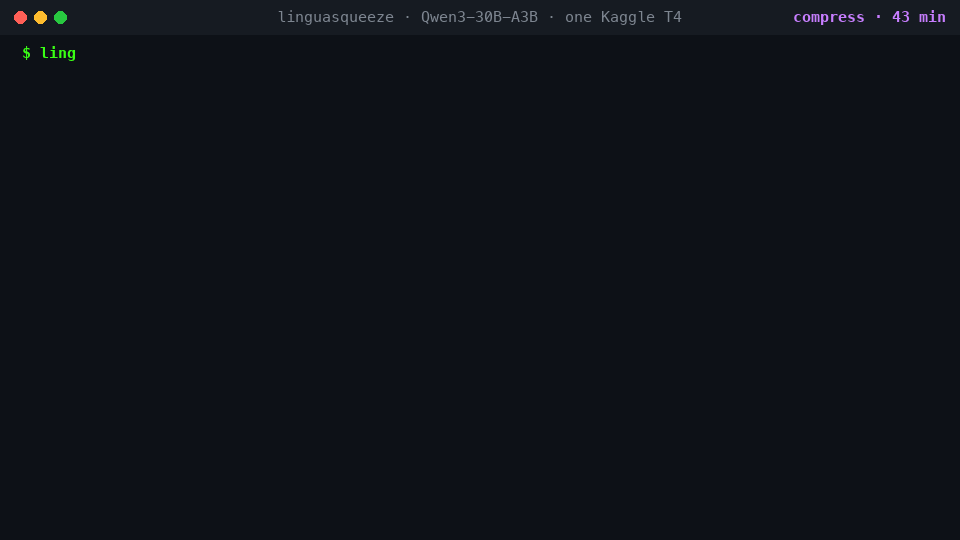

<div align="center">


## Compress for your language, not just for your hardware.

**Research-grade open-source tool: language-aware quantization for multilingual Mixture-of-Experts LLMs.**
A quantized model can look fine on one average score while it loses a smaller language. LinguaSqueeze calibrates on text in *your* language, gives more bits to the experts your language actually uses, and tells you what your language lost. On Qwen3-30B-A3B, choosing bits and calibration by English text instead costs Kazakh 16× more at the same memory.
First proof: Kazakh 🇰🇿 and Russian 🇷🇺 on Qwen3-30B-A3B — 61 GB → 15.24 GB, Kazakh perplexity +1.3%, on one free Kaggle GPU.<br>
Translation English → Kazakh at the same size: **+5.5 chrF** over the file compressed for English.

<sub>Formerly <b>LinguaPrune</b>: renamed on 20.11.2026 because the method mostly squeezes experts into fewer bits rather than removing them. Old links and <code>import linguaprune</code> keep working.</sub>

<p>
<a href="https://github.com/s0nakh/linguasqueeze/blob/main/LICENSE"></a>
<a href="https://github.com/s0nakh/linguasqueeze/actions/workflows/tests.yml"></a>
<a href="https://github.com/s0nakh/linguasqueeze"></a>
<a href="https://github.com/s0nakh/linguasqueeze/commits/main"></a>
<a href="https://github.com/s0nakh/linguasqueeze#roadmap"></a>
</p>
<p>
<a href="https://pypi.org/project/linguasqueeze/"></a>
<a href="https://www.python.org/"></a>
<a href="https://pytorch.org/"></a>
<a href="https://github.com/huggingface/transformers"></a>
<a href="https://www.kaggle.com/"></a>
</p>
<p>
<a href="https://huggingface.co/Qwen/Qwen3-30B-A3B-Instruct-2507"></a>
<a href="https://github.com/s0nakh/linguasqueeze#citation"></a>
<a href="https://github.com/s0nakh/linguasqueeze#evaluation"></a>
<a href="https://github.com/s0nakh/linguasqueeze#evaluation"></a>
<a href="https://github.com/s0nakh/linguasqueeze/blob/main/README.ru.md"></a>
<a href="https://doi.org/10.5281/zenodo.24281161"></a>
</p>

<p>🇷🇺 <a href="https://github.com/s0nakh/linguasqueeze/blob/main/README.ru.md">Русская версия</a> · 🇰🇿 <a href="https://github.com/s0nakh/linguasqueeze/blob/main/README.kk.md">Қазақша нұсқасы</a> · <a href="https://github.com/s0nakh/linguasqueeze/blob/main/docs/research-log.md">Research log</a> · <a href="https://github.com/s0nakh/linguasqueeze/blob/main/docs/prior-art.md">Related work</a></p>

<p><a href="https://github.com/s0nakh/linguasqueeze/blob/main/RESEARCH.md"></a></p>

<br>



<p><sub>The two commands on Qwen3-30B-A3B: verbatim output of our Kaggle T4 run, abridged (<a href="https://github.com/s0nakh/linguasqueeze/blob/main/experiments/cli/">experiments/cli</a>), 92 minutes shown in about 15 seconds; paths shortened.</sub></p>

</div>

---

### 🧭 Start here

| 📊 **The result in 2 minutes** | 🔁 **Reproduce it** | 📚 **The full history** |
|:---:|:---:|:---:|
| <a href="https://github.com/s0nakh/linguasqueeze#result">the proof table</a> | <a href="https://github.com/s0nakh/linguasqueeze#quick-start"><code>pip install</code> and two commands</a> | <a href="https://github.com/s0nakh/linguasqueeze/blob/main/RESEARCH.md">notebooks 01–10, controls</a> |

<p align="center"><b>Contents:</b><br><a href="https://github.com/s0nakh/linguasqueeze#result">📊 Results</a> &nbsp;·&nbsp; <a href="https://github.com/s0nakh/linguasqueeze#how">⚙️ How it works</a> &nbsp;·&nbsp; <a href="https://github.com/s0nakh/linguasqueeze#quick-start">🚀 Quick start</a> &nbsp;·&nbsp; <a href="https://github.com/s0nakh/linguasqueeze#who">👥 Who it is for</a> &nbsp;·&nbsp; <a href="https://github.com/s0nakh/linguasqueeze#roadmap">🗺️ Roadmap</a> &nbsp;·&nbsp; <a href="https://github.com/s0nakh/linguasqueeze#limitations">⚠️ Limitations</a> &nbsp;·&nbsp; <a href="https://github.com/s0nakh/linguasqueeze/blob/main/RESEARCH.md">📚 Research</a> &nbsp;·&nbsp; <a href="https://github.com/s0nakh/linguasqueeze#citation">📝 Citation</a></p>

<a id="result"></a>
<a id="evaluation"></a>
## 📊 Proven on Qwen3-30B-A3B

Each row links to the notebook and data behind it. Rows marked **simulated** use simulated quantization with the same bit allocation and calibration as the written file; all other rows are scored from the compressed file on disk.

|  | 🔬 What we measured | 📈 Result | 📎 Source |
|---|---|---|---|
| ✅ | File size | **61.1 → 15.24 GB (4.0× smaller)** | [](https://github.com/s0nakh/linguasqueeze/blob/main/notebooks/07_real_gptq_checkpoint.ipynb) |
| ✅ | Kazakh / Russian text (perplexity growth) | **+1.3% / +0.4%** | [](https://github.com/s0nakh/linguasqueeze/blob/main/notebooks/07_real_gptq_checkpoint.ipynb) |
| ✅ | Bits and calibration chosen by English text instead, same size | Kazakh **16× worse** (+14.3% vs. +0.9%) | [](https://github.com/s0nakh/linguasqueeze/blob/main/notebooks/06_qwen3_language_aware_gptq.ipynb)  |
| ✅ | Same size, but 4 bits go to random or least-used experts | Kazakh +3.5…+5.0% (random) and +6.3% (least-used) vs. **+1.3%** | [](https://github.com/s0nakh/linguasqueeze/blob/main/notebooks/07c_allocation_control.ipynb)  |
| ✅ | Translation English → Kazakh, same size | **+5.5 chrF** [+3.9, +7.1] vs. the file compressed for English | [](https://github.com/s0nakh/linguasqueeze/blob/main/experiments/translation/) |
| ✅ | Popular GGUF files at ~15 GB | nearest: Kazakh +4.3%; ours **+1.3%** | [](https://github.com/s0nakh/linguasqueeze/blob/main/notebooks/09_popular_quants_on_kazakh.ipynb) |
| ⚠️ | Knowledge, full KazMMLU (22,889 questions) | −1.8 / −1.6 points (kk / ru) | [](https://github.com/s0nakh/linguasqueeze/blob/main/notebooks/07b_full_kazmmlu.ipynb) |

<a id="how"></a>
## ⚙️ How it works

1. 📝 **Text in your language** — a few dozen documents are enough.
2. 🔀 **Router profile** — which experts of the MoE model this language actually uses, layer by layer.
3. 🎚️ **Bit allocation** — experts that carry 90% of the language's traffic keep 4 bits, the rest get 3.
4. 🧮 **GPTQ per expert** — each expert is calibrated on the tokens of your language routed to it.
5. 📦 **Standard GPTQ file** — written layer by layer, so a 61 GB model is processed on one 16 GB GPU.
6. 📊 **Evaluation** — the original and the compressed file on the same items: what your language lost.

<a id="quick-start"></a>
## 🚀 Quick start

```bash
pip install linguasqueeze
linguasqueeze --version   # linguasqueeze 0.8.2
```

```bash
export MODEL="./Qwen3-30B-A3B-Instruct-2507"
export OUT="./qwen3-30b-kk-ru"

# 1. compress — calibrate on text in your language;
#    experts that carry 90% of its traffic keep 4 bits, the rest get 3
linguasqueeze compress \
  --model "$MODEL" \
  --calibration-data "kazakh.txt" "russian.txt" \
  --bits 4,3 \
  --output "$OUT"

# 2. evaluate — the same items for both models;
#    every number of the compressed model comes from its files
linguasqueeze evaluate \
  --original "$MODEL" \
  --compressed "$OUT" \
  --text "kk=kazakh_test.txt" --text "ru=russian_test.txt" \
  --exam --report "report.json"
```

Calibration and test files are plain UTF-8 text, documents separated by an empty line. The command accepts text in any language; quality has been measured only for Kazakh and Russian.
`--exam` adds the fixed exam of notebook 07: Belebele (150 passages each in kk, ru, en) and a KazMMLU sample of up to 400 questions per language (kk, ru), an equal number per subject (370 kk and 392 ru in our run). The KazMMLU numbers below come from the full test split (22,889 questions, notebook 07b), so a sample run gives somewhat different values. The quick exam is kept small so that it runs on Kaggle in reasonable time; for publication-grade KazMMLU numbers use notebook 07b. `compress` and `evaluate` stream the model one layer at a time, so a 61 GB source model is processed on one 16 GB GPU; what the compressed model needs to run depends on your runtime and context length.
Supported for now: `compress` — Qwen3-MoE checkpoints in safetensors (run end to end on Qwen3-30B-A3B); `evaluate` — Qwen3-MoE and Qwen3.5/3.6-MoE.

What `evaluate` reports (abbreviated), with the numbers we measured for Qwen3-30B-A3B with the same code ([notebook 07](https://github.com/s0nakh/linguasqueeze/blob/main/notebooks/07_real_gptq_checkpoint.py), [07b](https://github.com/s0nakh/linguasqueeze/blob/main/notebooks/07b_full_kazmmlu.py)):

```
Original size:     61.1 GB
Compressed size:   15.2 GB
Compression:       4.0x
Perplexity kk:     +1.3%
Perplexity ru:     +0.4%
KazMMLU kk:        -1.8 pts
KazMMLU ru:        -1.6 pts
```

**These two commands, run on Qwen3-30B-A3B** (one Kaggle T4, 43 min for `compress`, 49 min for `evaluate`): 15.24 GB file, 4.0× smaller; Belebele perplexity kk +0.6%, ru +0.4%, en +4.0%; KazMMLU sample kk −0.8 pts [−3.5, +1.9], ru −1.5 pts [−4.3, +1.0] (370 + 392 questions). The calibration articles are those of notebook 07 with empty lines collapsed, so the numbers are close to, not identical with, notebook 07. Report, run summary with timings and script: [`experiments/cli/`](https://github.com/s0nakh/linguasqueeze/blob/main/experiments/cli/).

Speed and memory at inference depend on your runtime, so `evaluate` does not guess them; measure them there.

## 📍 Current status (v0.8.2)

- ✅ **Verified:** `compress` → `evaluate` on Qwen3-30B-A3B for Kazakh + Russian, 4/3-bit, mixed export in the standard GPTQ layout; full KazMMLU; translation English → Kazakh.
- 🧪 **Experimental:** other languages (the commands take text in any language, quality not yet measured); `evaluate` on Qwen3.5/3.6-MoE; other bit budgets.
- ⛔ **Not supported yet:** running mixed-width files in vLLM, llama.cpp, Ollama or LM Studio · compressing Qwen3.5/3.6-MoE · dense (non-MoE) models · speed and memory measurements of the compressed model.

<a id="who"></a>
## 👥 Who it is for

A tool that helps a small team compress a large model for its own language on affordable hardware — and see what that language lost after compression.

- **Model developers** — compress an open model for your users' language and check it before release.
- **Researchers and universities** — reproducible measurements per language: size, perplexity, exam, with error bars.
- **Small teams** — no expensive GPUs: compressing and evaluating the source model runs on one 16 GB card, such as the free one on Kaggle. Memory for running the compressed model depends on your runtime.
- **Any language** — Kazakh, Uzbek, Arabic, Hindi, Ukrainian, Vietnamese: all you need is text in your language. Quality has been measured for Kazakh and Russian so far.

> **Why:** compression is usually judged by size and speed. LinguaSqueeze also shows what happened to your language after compression.

<a id="roadmap"></a>
## 🗺️ Roadmap

**✅ Done**

| 🔢 # | 🧪 Step | 📈 Result |
|---|---|---|
| ✅ 01–05 | Routing profile, pruning, mixed precision, GPTQ on OLMoE | the method, built on a small MoE |
| ✅ 06 | Qwen3-30B-A3B: English vs. kk+ru at equal memory | English costs Kazakh **16×** more perplexity |
| ✅ 07 | A real compressed file, scored from disk | **61.1 → 15.24 GB (4.0×)**, kk +1.3%, ru +0.4% |
| ✅ 07b | Full KazMMLU (22,889 questions) | −1.8 / −1.6 points (4/3-bit), −1.1 / −0.4 (4-bit) |
| ✅ 07c | Is it the bit allocation? | yes: most-used experts kk +1.3%, random +3.5…+5.0%, least-used +6.3% |
| ✅ 08 | The file in GPTQModel | answers in kk, ru and en; perplexity matches 07 within 0.1% |
| ✅ 09 | Against 9 popular GGUF files | ahead at ~15 GB (+1.3% vs. +4.3% for the nearest); a tie at 17–18 GB |
| ✅ 10 | Calibration language at 2 bits | helps little (+18.9% → +15.1%); the allocation matters more ([log](https://github.com/s0nakh/linguasqueeze/blob/main/docs/research-log.md#2026-11-14--10--does-the-calibration-language-matter-at-2-bits)) |
| ✅ HF | Both files public on Hugging Face | [4/3-bit](https://huggingface.co/s0nakh/Qwen3-30B-A3B-Instruct-2507-kk-ru-GPTQ-4-3bit), [4-bit](https://huggingface.co/s0nakh/Qwen3-30B-A3B-Instruct-2507-kk-ru-GPTQ-4bit); cards in EN, RU, KK |
| ✅ v0.8 | `linguasqueeze compress` / `evaluate` | any language from text files; run end to end on Qwen3-30B-A3B |
| ✅ — | Calibration language and knowledge (Qwen3.6, 3-bit) | no difference: KazMMLU kk +0.4 [−1.1, +1.8] |
| ✅ — | Translation English → Kazakh, same size | **+5.5 chrF** [+3.9, +7.1] for the file compressed for kk+ru |
| ✅ v0.8.2 | `pip install linguasqueeze` | on [PyPI](https://pypi.org/project/linguasqueeze/), published from a version tag by GitHub Actions |

**🚀 Next**

| 🚦 Status | 🧭 Step |
|---|---|
| 🔥 now | A ~2.5-bit file for 10–12 GB, where popular files lose 10–12% of Kazakh |
| ⬜ | A ready Kaggle notebook: compress a model for your language in one click |
| ⬜ | Our 4-bit file in the vLLM serving engine, compared with popular files in the same engine |
| ⬜ | An exam on Kazakhstan's laws and official documents (kk, ru) |
| ⬜ | MERA (Russian) |
| ⬜ | A second language pair and a second MoE family |

<a id="limitations"></a>
## ⚠️ Limitations

- The main result is one model (Qwen3-30B-A3B) and one seed; the first language pair is Kazakh + Russian. Do not read it as proof that every model or language gains equally.
- Compression is not lossless: on the full KazMMLU the 4/3-bit file loses 1.8 points in Kazakh and 1.6 in Russian.
- The calibration language did not change knowledge. On Qwen3.6-35B-A3B with every expert at 3 bits (same size), Kazakh + Russian calibration against English calibration scored KazMMLU kk +0.4 points [−1.1, +1.8] on 3,000 questions and ru +1.8 [−0.2, +3.6] on 1,200 questions: no significant difference. The gain we measure is in how the model handles text in the language (perplexity and translation quality), not in exam knowledge. Data: [`experiments/calibration-language/`](https://github.com/s0nakh/linguasqueeze/blob/main/experiments/calibration-language/).
- At 2 bits the calibration language helps little (Kazakh loss +18.9% → +15.1%, notebook 10); the bit allocation matters more.
- Common fast runtimes cannot yet run different bit widths for experts of one layer. GPTQModel runs the file, slowly (about 1.6 tokens/s on two T4).
- `compress` writes files for the Qwen3-MoE layout only; Qwen3.5/3.6-MoE can be scored with `evaluate` but not yet compressed. Dense (non-MoE) models are not supported.
- Datasets and models keep their own licenses; see [THIRD_PARTY_NOTICES.md](https://github.com/s0nakh/linguasqueeze/blob/main/THIRD_PARTY_NOTICES.md).

## 🤝 Contributing

Most welcome: reproductions on other GPUs and runtimes, support for more MoE architectures, calibration text for more languages (only text you may redistribute), independent baselines, and negative results that show where language-aware compression does not help. Please open an issue with a minimal reproduction first.

## 📚 Research and full history

Notebooks 01–10, the controls, the negative results and every decision along the way: **[open the research page →](https://github.com/s0nakh/linguasqueeze/blob/main/RESEARCH.md)**

<a id="paper"></a>
## 📄 Paper

The study is available as a preprint (CC BY 4.0) in three languages. The English version is the original; the Russian and Kazakh versions are translations.

- 🇬🇧 [English](https://doi.org/10.5281/zenodo.24281161)
- 🇷🇺 [Русский](https://doi.org/10.5281/zenodo.24281163)
- 🇰🇿 [Қазақша](https://doi.org/10.5281/zenodo.24281169)

**To cite the paper** (the English original):

```bibtex
@misc{akhmetova2026linguaprune_paper,
  title     = {LinguaPrune: Language-Aware Mixed-Precision Quantization of a Mixture-of-Experts LLM for Kazakh and Russian},
  author    = {Akhmetova, Sophia},
  year      = {2026},
  publisher = {Zenodo},
  doi       = {10.5281/zenodo.24281161},
  url       = {https://doi.org/10.5281/zenodo.24281161}
}
```

```text
Akhmetova, S. (2026). LinguaPrune: Language-aware mixed-precision quantization of a Mixture-of-Experts LLM for Kazakh and Russian [Preprint]. Zenodo. https://doi.org/10.5281/zenodo.24281161
```

<a id="citation"></a>
## 📝 Citation

<p align="center"><a href="https://github.com/s0nakh/linguasqueeze#citation"></a></p>

If you use LinguaSqueeze in your work, please cite it. Each block below has a copy button; on GitHub, **Cite this repository** in the sidebar gives the same from [`CITATION.cff`](https://github.com/s0nakh/linguasqueeze/blob/main/CITATION.cff).

**BibTeX**

```bibtex
@software{linguasqueeze2026,
  title   = {LinguaSqueeze: Language-aware compression for Mixture-of-Experts LLMs},
  author  = {Akhmetova, Sophia},
  year    = {2026},
  version = {0.8.2},
  url     = {https://github.com/s0nakh/linguasqueeze}
}
```

**APA**

```text
Akhmetova, S. (2026). LinguaSqueeze: Language-aware compression for Mixture-of-Experts LLMs (Version 0.8.2) [Computer software]. https://github.com/s0nakh/linguasqueeze
```

## ⚖️ License

The code is licensed under [Apache-2.0](https://github.com/s0nakh/linguasqueeze/blob/main/LICENSE). Models, datasets and tools keep their own licenses; the full list, checked against each source, is in [`THIRD_PARTY_NOTICES.md`](https://github.com/s0nakh/linguasqueeze/blob/main/THIRD_PARTY_NOTICES.md). In short:

| Resource | License | How it is used here |
|---|---|---|
| Qwen3-30B-A3B-Instruct-2507, OLMoE-1B-7B | Apache-2.0 | Models we compress and measure |
| [Belebele](https://huggingface.co/datasets/facebook/belebele) (Bandarkar et al., ACL 2024) | CC-BY-SA-4.0 | Evaluation; scores only, no passages redistributed |
| [KazMMLU](https://huggingface.co/datasets/MBZUAI/KazMMLU) (Togmanov et al., ACL 2025) | CC-BY-NC-4.0 | Evaluation for non-commercial research only |
| Wikipedia (kk, ru, en) | CC-BY-SA-3.0 / GFDL | Calibration text only |
| llama.cpp, llama-cpp-python | MIT | GGUF tools and inference |
